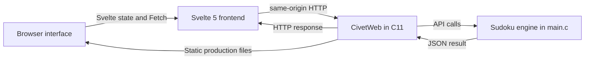

# Sudoku Studio

Sudoku Studio is a web application for solving, playing, and checking Sudoku puzzles, designed to run locally or as a Docker web service. The user interface is built with Svelte 5 and Vite. A C11 program using CivetWeb serves the production frontend and performs all Sudoku validation, solving, solution counting, and puzzle generation. The browser communicates with the C API on the same origin; no separate application service or database is required.

## Table of contents

1. [Problem statement](#1-problem-statement)
2. [Project objectives](#2-project-objectives)
3. [Sudoku rules](#3-sudoku-rules)
4. [Features](#4-features)
5. [Technology stack](#5-technology-stack)
6. [System architecture](#6-system-architecture)
7. [Application workflow](#7-application-workflow)
8. [Algorithm explanation](#8-algorithm-explanation)
9. [C source code organisation](#9-c-source-code-organisation)
10. [Frontend source code organisation](#10-frontend-source-code-organisation)
11. [Directory structure](#11-directory-structure)
12. [API documentation](#12-api-documentation)
13. [Installation and prerequisites](#13-installation-and-prerequisites)
14. [Build instructions](#14-build-instructions)
15. [Local execution](#15-local-execution)
16. [Testing](#16-testing)
17. [Performance analysis](#17-performance-analysis)
18. [Error handling and design considerations](#18-error-handling-and-design-considerations)
19. [Third-party dependency and licence](#19-third-party-dependency-and-licence)
20. [Limitations and future improvements](#20-limitations-and-future-improvements)
21. [Render deployment with Docker](#21-render-deployment-with-docker)

## 1. Problem statement

A partially completed Sudoku is a 9×9 grid with some fixed clues and some empty cells. A solver must fill the empty cells while respecting the row, column, and 3×3 box constraints. A useful application should also reject contradictory input, tell a player whether a manually completed board is correct, and provide valid puzzles to practise with.

Sudoku Studio combines those tasks in one local application. It accepts curated, generated, and custom puzzles. Its C solver finds a solution using recursive backtracking, while the C validation endpoint checks a player's completed grid independently.

## 2. Project objectives

The project demonstrates how to:

- Represent a 9×9 board with a two-dimensional C array.
- Organise a program into focused functions, loops, and conditional statements.
- Apply recursion and backtracking to a constraint problem.
- Validate untrusted input before using it in an algorithm.
- Use a bounded solution counter to test puzzle uniqueness.
- Generate puzzles by transforming a valid completed board and removing clues carefully.
- Expose a C program through HTTP and connect it to an interactive frontend.
- Measure solver elapsed time and count candidate attempts.

## 3. Sudoku rules

A completed board must satisfy all three rules:

1. Each row contains the digits 1–9 with no repeated digit.
2. Each column contains the digits 1–9 with no repeated digit.
3. Each 3×3 subgrid contains the digits 1–9 with no repeated digit.

The C backend stores the board as `int grid[9][9]`. The value `0` means that a cell is empty. Digits 1–9 are the clues or entries.

## 4. Features

- **Auto Solve:** sends the current board to the C solver, then progressively reveals the returned solution. The frontend does not solve the puzzle.
- **Play & Check:** lets the user fill editable cells and sends both the original puzzle and the attempted board to C for authoritative checking.
- **Curated puzzles:** Easy, Medium, and Hard fixtures are stored in `main.c`.
- **Random puzzles:** C creates a complete valid grid, removes clues, and keeps a removal only when uniqueness remains.
- **Custom puzzles:** accepts exactly 81 cells. Digits are retained; zeroes, spaces, and periods are treated as empty cells by the frontend and normalized to zeroes before validation.
- **Input validation:** checks length, characters, digit range, and repeated clues before solving or loading custom input.
- **Unique-solution checking:** the generator counts at most two solutions to distinguish none, one, and multiple.
- **Solver metrics:** reports elapsed time inside C and the number of candidate digits tested by the recursive solver.
- **Interactive board:** highlights the selected cell, its row, column, and 3×3 box. Original clues are locked. The interface supports digits 1–9, arrow-key navigation, Backspace, Delete, reset, and clear.
- **Feedback:** displays loading, success, and error messages. Matching entries can be highlighted for guidance; the C response remains authoritative.

Difficulty profiles use approximate clue targets. A clue count is not a human difficulty rating.

## 5. Technology stack

| Technology | Purpose |
| --- | --- |
| Svelte 5 | Reactive frontend state and component rendering |
| Vite | Frontend development server and static production build |
| HTML5 | Vite entry document and application mount point |
| CSS3 | Parchment-and-sage visual system, responsive layout, and motion |
| JavaScript | UI interactions, input presentation, Fetch requests, and solution reveal animation |
| C11 | Sudoku validation, recursive solving, solution counting, and generation |
| CivetWeb 1.16 | Local HTTP server, static frontend delivery, and API request handling |
| Clang | Compiles the C application with `-Wall -Wextra -Wpedantic` |
| CMake | Not used by this project; the backend is compiled directly with Clang. |

The frontend does not contain Sudoku solving or uniqueness algorithms. Node.js and npm are used for frontend package installation and Vite compilation; Node does not serve the production application or implement the backend.

## 6. System architecture



In development, Vite serves the frontend at port `5173` and proxies `/api` to CivetWeb at port `8080`. In production, Vite emits static files into `dist/`; the C executable serves both those files and the API. Local servers default to loopback. The Docker image sets `HOST=0.0.0.0` and uses the `PORT` environment variable (default `10000`) so Render can route requests to it.

## 7. Application workflow

### Load a preset or random puzzle

1. Select Easy, Medium, Hard, or Random.
2. The Svelte component requests a preset with `GET /api/puzzle` or a generated puzzle with `POST /api/generate`.
3. The C handler returns an 81-digit string. The component stores it as both the original puzzle and current board, and marks every nonzero clue as locked.

### Enter a custom puzzle

1. Select Custom and enter 81 cells, using a digit for a clue and `0`, a space, or a period for an empty cell.
2. The frontend removes line separators and normalizes blanks to zeroes.
3. It sends the 81 digits to `POST /api/validate`. The C backend checks the payload and clue conflicts before the grid is loaded.

### Solve automatically

1. Press **Solve puzzle**.
2. The frontend sends the current 81 digits to `POST /api/solve`.
3. C validates the clues, runs recursive backtracking, measures that search, and returns the completed grid and counters.
4. Svelte reveals the returned values in a short sequence. This is a presentation animation; recursion stays in C.

### Play and check

1. Select **Play & Check** and enter digits in empty cells. Arrow keys move the selected cell; Backspace, Delete, or `0` clears it.
2. Press **Check solution**. The frontend sends 162 digits: the original puzzle followed by the current board.
3. C checks completeness, all Sudoku constraints, and preservation of original clues. It returns `correct`, `incorrect`, or `incomplete` (or `invalid_input` for invalid original clues).

### Generate a puzzle

1. Choose Random or a difficulty profile.
2. C permutes a valid completed grid and visits shuffled cell positions for clue removal.
3. After each removal, C counts solutions with a limit of two. The clue is restored if the puzzle becomes unsolvable or has multiple solutions.
4. The generated 81-digit puzzle is returned to the frontend.

## 8. Algorithm explanation

### Recursive backtracking

The solver finds the first empty cell and tries digits 1 through 9. `isSafe()` checks whether a candidate is absent from the cell's row, column, and 3×3 box. If safe, the solver places it temporarily and calls itself to fill the next empty cell. A failed recursive branch means that choice cannot lead to a complete board, so the value is reset to zero and the next digit is tried. A solved child returns success, which propagates through each parent call.

```text
solveSudoku(grid):
    find an empty cell (emptyRow, emptyCol)
    if there is no empty cell:
        return whether the board is complete and valid

    for candidate from 1 through 9:
        count this candidate attempt
        if isSafe(grid, emptyRow, emptyCol, candidate):
            place candidate in the empty cell
            if solveSudoku(grid) succeeds:
                return success
            reset the cell to 0

    return failure
```

`findEmptyCell()` currently chooses the first empty cell in row-major order. It is simple to follow, though a future solver could choose the cell with the fewest legal candidates to reduce search.

### Counting solutions

`countSolutions(grid, limit)` copies the input grid so it can explore candidates without changing the caller's board. It stops once `limit` solutions are found. The generator passes `2`, because it only needs to distinguish zero solutions, exactly one, and more than one. Stopping at two avoids enumerating every solution to an ambiguous puzzle.

### Random puzzle generation

1. Fill a board with a known cyclic Sudoku pattern, which is valid by construction.
2. Shuffle digit mappings, row bands, rows within bands, column stacks, and columns within stacks. Optionally transpose the result. These transformations preserve Sudoku constraints while changing the arrangement.
3. Shuffle all 81 cell positions and tentatively erase each clue.
4. Count solutions up to two. Keep the removal only when exactly one solution remains; otherwise restore the saved clue.
5. Stop around the chosen approximate clue target and confirm that the final puzzle remains unique.

The target number of clues is a profile setting, not proof of a human-rated difficulty.

## 9. C source code organisation

All first-party backend code is in [`main.c`](main.c), including the server entry point, engine functions, request handlers, and the C self-test mode.

| Function | Responsibility |
| --- | --- |
| `isSafe()` | Test one candidate against a row, column, and box. |
| `isValidGrid()` | Reject out-of-range values and repeated nonzero clues. |
| `isCompleteSolution()` | Require a full board that passes grid validation. |
| `findEmptyCell()` | Return the first empty cell's row and column. |
| `solveSudoku()` | Recursively fill the board; undo a choice when it leads to a dead end. |
| `countRecursive()` | Search for solutions until its remaining limit is reached. |
| `countSolutions()` | Copy a grid and count up to the requested limit without altering caller data. |
| `generatePuzzle()` | Randomize a valid full grid, remove clues, and preserve uniqueness. |
| `parseGrid()` / `serializeGrid()` | Convert between a compact 81-digit payload and the 2D grid. |
| `preservesClues()` | Ensure an attempted solution retains each original nonzero clue. |
| `apiHandler()` | Route health, puzzle, generation, validation, solve, and check requests. |
| `nowMs()` | Measure elapsed monotonic time in milliseconds. |
| `runSelfTests()` | Run focused engine checks using the same one-file C implementation. |

`attempts` counts candidate digits considered by `solveSudoku()`, including digits rejected immediately by `isSafe()`. `limit` is the maximum number of solutions still needed by the counting recursion. `emptyRow` and `emptyCol` identify the next zero cell. In the check route, `originalGrid` is the puzzle sent by the client and `userGrid` is the player's current board. `foundSolutions` is the count accumulated by `countRecursive()`; it prevents unnecessary searching after the limit is met.

For a function-by-function explanation with recursion details, see [`docs/C_CODE_WALKTHROUGH.md`](docs/C_CODE_WALKTHROUGH.md).

## 10. Frontend source code organisation

- [`index.html`](index.html) is the Vite document. It provides the `#app` mount node and loads the JavaScript entry point.
- [`index.css`](index.css) holds all global styles, including the responsive layout, board cells, separators, focus states, and reduced-motion rules. It uses local font names with system fallbacks and makes no remote font request.
- [`index.js`](index.js) imports Svelte, the component, and global CSS, then mounts the application.
- [`App.svelte`](App.svelte) contains the interface and its logic. Svelte 5 `$state` runes represent mode, difficulty, grid data, selection, requests, status, and performance metrics. `$derived` computes the filled-cell count.

The component uses Fetch for API calls. Its JavaScript conflict scan is used only to highlight likely conflicts; `/api/check` supplies the authoritative result. The cell reveal animation displays the solution returned by C and never performs solving in the browser.

## 11. Directory structure

```text
sudoku-studio-final/
├── index.html                 # Vite HTML entry
├── index.css                  # Global design and responsive styles
├── index.js                   # Svelte mount and CSS import
├── App.svelte                 # Main Svelte interface and interactions
├── main.c                     # Complete first-party C server and Sudoku engine
├── package.json               # Svelte/Vite dependencies and frontend commands
├── package-lock.json          # Locked frontend dependency versions
├── vite.config.js             # Svelte plugin, dev proxy, and dist output
├── Dockerfile                 # Multi-stage production container build
├── .dockerignore              # Excludes local and sensitive files from build context
├── third_party/civetweb/      # CivetWeb implementation, header, credits, licence
├── scripts/
│   ├── build.sh               # Vite production build and C compilation
│   ├── run-local.sh           # Starts the production C server
│   └── test.sh                # C self-tests and HTTP/static smoke tests
└── docs/C_CODE_WALKTHROUGH.md # Educational guide to main.c
```

## 12. API documentation

POST bodies use `Content-Type: text/plain`. Successful API results and errors are JSON. A puzzle or solution is encoded as 81 ASCII digits, row by row. The check body is the original 81 digits followed by the user's 81 digits.

| Endpoint | Method | Request | Success response | Failure response |
| --- | --- | --- | --- | --- |
| `/api/health` | GET | No body | HTTP 200, `{"status":"ok", ...}` | HTTP 400 if the method is not GET |
| `/api/puzzle?difficulty=easy` | GET | `difficulty=easy`, `medium`, or `hard` | HTTP 200 with `status`, `difficulty`, and `puzzle` | HTTP 400 for missing or unsupported difficulty |
| `/api/generate` | POST | `easy`, `medium`, `hard`, or `random` | HTTP 200 with `puzzle` and `unique_solution:true` | HTTP 400 for invalid payload/difficulty; HTTP 422 if generation fails |
| `/api/validate` | POST | Exactly 81 digits; `0` is empty | HTTP 200 with `{"status":"valid"}` | HTTP 400 for malformed payload; HTTP 422 for conflicting clues |
| `/api/solve` | POST | Exactly 81 digits | HTTP 200 with `status:"solved"`, `solution`, `candidate_attempts`, and `elapsed_ms` | HTTP 400 for malformed payload; HTTP 422 for invalid or unsolvable clues |
| `/api/check` | POST | Exactly 162 digits: original puzzle + user board | HTTP 200 with `correct`, `incorrect`, or `incomplete` | HTTP 400 for malformed length/characters; HTTP 200 with `invalid_input` for invalid original clues |

The C reader caps request bodies at 255 bytes. Endpoints reject incorrect lengths and non-digit content. The frontend converts custom spaces and periods to zeroes before calling validation.

## 13. Installation and prerequisites

The project targets local macOS execution and requires:

- Clang and the macOS command-line developer tools / C11 SDK.
- Node.js and npm for installing frontend dependencies and building the static bundle.
- `curl` for the API and static-delivery test script.

Check the tools with:

```sh
clang --version
node --version
npm --version
curl --version
```

If Clang is missing, install Apple's Command Line Tools with `xcode-select --install`. Install a current Node.js LTS release using the official macOS installer or a package manager such as Homebrew. npm is included with Node.js. No global Vite installation is needed. CivetWeb v1.16 is already included in `third_party/civetweb/`.

## 14. Build instructions

From the project root, install the exact locked frontend dependencies and build the frontend and backend:

```sh
npm ci
npm run build
clang -std=c11 -O2 -Wall -Wextra -Wpedantic \
  -DNO_SSL -DNO_WEBSOCKET \
  -Ithird_party/civetweb/include \
  main.c third_party/civetweb/src/civetweb.c \
  -o build/sudoku-studio
```

The equivalent one-command build is:

```sh
./scripts/build.sh
```

Vite writes production HTML, CSS, and JavaScript to `dist/`. Clang writes the executable to `build/sudoku-studio`. The C build disables unused CivetWeb SSL and WebSocket features. It enables `-Wall -Wextra -Wpedantic` and currently compiles without first-party warnings.

## 15. Local execution

### Production mode

Build first, then start the C server:

```sh
./scripts/build.sh
./scripts/run-local.sh
```

Open <http://127.0.0.1:8080>. The C server defaults to `127.0.0.1` and serves the static files from `dist/`. Stop it with Ctrl+C. No Node process is needed after the build.

### Development mode

Build once so the C executable exists. In terminal one, serve the API and a static copy (Vite handles live frontend delivery separately):

```sh
./build/sudoku-studio 8080 "$PWD/dist"
```

In terminal two, run Vite:

```sh
npm run dev
```

Open <http://127.0.0.1:5173>. Vite proxies `/api` requests to `http://127.0.0.1:8080`. Stop both processes with Ctrl+C.

## 16. Testing

Run all included C and HTTP checks with:

```sh
./scripts/test.sh
```

The script rebuilds the project, runs the C self-test mode, starts CivetWeb locally, checks the API and static production assets, then stops the test server.

The C checks cover all three preset puzzles (validity, uniqueness, and solving), row/column/box conflicts, incomplete boards, custom input length and characters, clue preservation, a valid but unsolvable board, empty-cell search, and unique generated puzzles at Easy, Medium, Hard, and Random profiles.

The HTTP checks cover health, static HTML and JavaScript asset delivery, all preset routes, custom-grid validation, solving, malformed length and characters, invalid row/column/box clues, unsolvable input, incomplete/correct/incorrect/manual clue-modification results, random generation, and invalid difficulty.

The shell test does not automate browser interaction, responsive screenshots, or a complete accessibility audit.

## 17. Performance analysis

`elapsed_ms` measures the C `solveSudoku()` call with a monotonic clock. It includes validation performed by recursive calls as well as the candidate search. It excludes the HTTP response and the frontend's reveal animation.

`candidate_attempts` increments once for each digit 1–9 considered at each search cell, including candidates rejected by `isSafe()`. Comparing the count across puzzles gives a rough indication of search work; elapsed time also depends on the processor, compiler settings, and operating-system load. Measurements can vary between runs and machines. No benchmark result is claimed here.

## 18. Error handling and design considerations

- The C backend checks body size, content type, length, characters, value range, and clue conflicts before engine operations.
- Contradictory clues and unsolvable puzzles are rejected rather than returned as solutions.
- The solution counter stops at two because puzzle generation only needs to know whether a puzzle is unique.
- `preservesClues()` ensures the solver result and manual answer keep all original nonzero cells unchanged.
- API failures use structured JSON and HTTP 400, 413, or 422 responses as appropriate. Manual check statuses are returned as JSON on HTTP 200 so the UI can display `correct`, `incorrect`, or `incomplete`.
- Local execution defaults to `127.0.0.1`; the Docker image sets `HOST=0.0.0.0` for Render's web-service routing.
- Frontend and backend are separate processes in development. In production the C process serves static frontend assets and handles APIs; it does not delegate backend work to Node.

## 19. Third-party dependency and licence

CivetWeb v1.16 supplies the embedded HTTP server and static file service. The project does not claim authorship of CivetWeb. Its source is under `third_party/civetweb/src/`, the public header is under `third_party/civetweb/include/`, and its licence and contributor attribution are in [`third_party/civetweb/LICENSE.md`](third_party/civetweb/LICENSE.md) and [`third_party/civetweb/CREDITS.md`](third_party/civetweb/CREDITS.md).

## 20. Limitations and future improvements

The current solver uses row-major first-empty selection and plain candidate iteration. Random difficulty uses approximate clue targets rather than a human solving-technique rating. The custom editor accepts a compact 81-cell grid rather than a visual puzzle-import tool. The included shell checks do not automate a full browser accessibility audit.

Possible future work includes more curated puzzles, human-oriented difficulty classification, candidate heuristics such as minimum-remaining-values search, optional solver-step visualisation, and broader automated browser and accessibility checks. These are extensions, not current features.

## 21. Render deployment with Docker

The root [`Dockerfile`](Dockerfile) builds the frontend with `npm ci` and compiles the C11 server with the vendored CivetWeb source. The final image contains the C executable and Vite's static output; Node.js and the C compiler are only present in build stages. CivetWeb serves the frontend and `/api/*` routes from one origin. The image declares a Docker health check against `/api/health`.

### Deploy on Render

1. In Render, create a **New Web Service** and connect `thekrizan/sudoku-studio`.
2. Select branch `main` and the **Docker** runtime. Use the repository root as the Docker build context and `Dockerfile` as the Dockerfile path.
3. Set the HTTP health check path to `/api/health` in the service's advanced settings.
4. Deploy. No application secrets or additional environment variables are required. Render supplies `PORT`; the image defaults it to `10000` when running elsewhere and binds CivetWeb to `0.0.0.0`.

### Build and run locally

From the repository root:

```sh
docker build -t sudoku-studio .
docker run --rm --name sudoku-studio -e PORT=18080 -p 18080:18080 sudoku-studio
```

Then open <http://127.0.0.1:18080> and check the service with:

```sh
curl http://127.0.0.1:18080/api/health
```

To stop the container, press Ctrl+C. The runtime image does not require Node.js.
